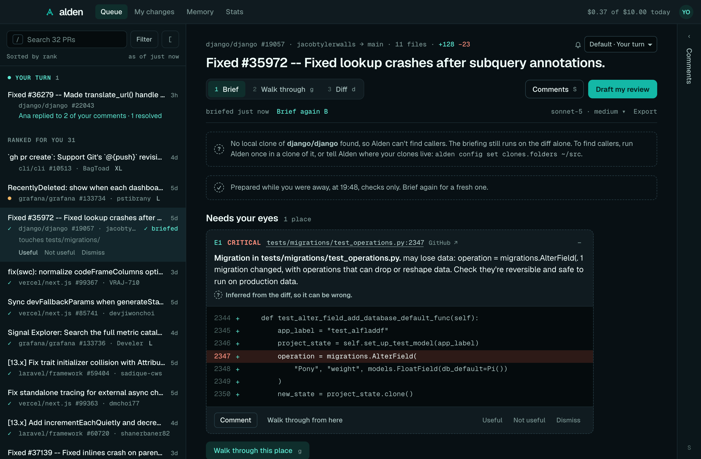
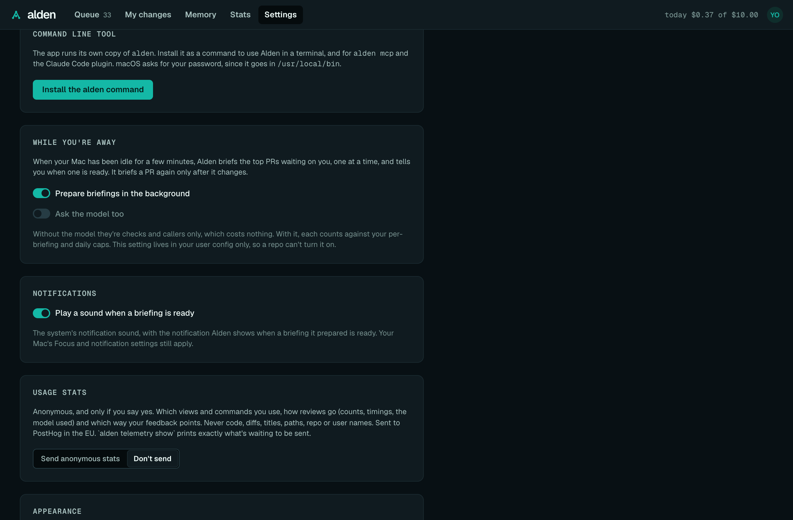

# The desktop app

On macOS, Alden can live in a window and the menu bar. The menu bar shows how many PRs wait on you, and while you're
away from your Mac, Alden briefs the top ones so they're ready when you come back.

The app is the same Alden as the command line tool. It runs its own copy of `alden ui` and shows it in a window, so
the queue, briefings, the Diff tab, guided review and comments work exactly as in
[Alden in your browser](web-ui.md). This page covers what's different about the app.



## Install

```sh
brew install --cask getalden/tap/alden-desktop
```

Or download `Alden-<version>-universal.dmg` from the [releases page](https://github.com/getalden/homebrew-tap/releases)
and drag Alden to Applications.

It runs on Apple silicon and Intel Macs with macOS 12 or later. It's signed and notarized, so it opens without a
warning.

## First run

Open Alden from Applications. Its icon appears in the menu bar, and its window opens on your queue.

### Sign in

If Alden isn't signed in to GitHub, the window says so:

- **Sign in with GitHub** shows a one-time code and opens GitHub's page in your browser. The app picks up your approval
  by itself.
- **Use my GitHub CLI sign-in** uses the GitHub CLI's (`gh`), when it's signed in on your Mac. The app looks for `gh`
  where Homebrew installs it.

The app uses the same sign-in as the command line tool: the token `alden auth login` stored in your keychain, or the
GitHub CLI's. If you've already signed in in a terminal, there's nothing to do. If you sign in in a terminal while the
app is open, **I've signed in** looks again, and if Alden still can't see a sign-in, says why. See
[Getting started](getting-started.md#sign-in-to-github).

### Set up a model

An app opened from the Finder never sees your shell's environment, so it doesn't see `ANTHROPIC_API_KEY`. Without a
model, Alden runs its checks and finds callers, which costs nothing. To add one, use **Set up a model** in a PR's
toolbar: paste an Anthropic API key (Alden checks it, then keeps it in your keychain), use a local model through
Ollama, or stay with checks only. The next briefing uses it, with no restart. See
[Set up a model](web-ui.md#set-up-a-model).

`alden setup` or `alden auth model` in a terminal, or Settings → Anthropic API key, work too. The app doesn't see
`OLLAMA_HOST` either: setting up a local model from a terminal where it's set writes the address into your config,
which the app reads.

### Choose a repo folder

The app runs Alden in your home folder until you choose a repo. **Choose repo folder…** in the menu bar picks a clone
to run in, and Alden remembers it. That folder is where **My changes** reads your uncommitted changes from.

Right after you choose, the window shows that repo's PRs only, and says where callers now come from. **Show all
repos** goes back to everything.

PR briefings find callers in any clone Alden knows, not only the chosen folder: each clone you've run Alden in, and
the clones under `clones.folders` (see [Configuration](configuration.md#clones)). The briefing says which clone it
used.

### The `alden` command

The app comes with the `alden` command, so the terminal, `alden mcp` and the
[Claude Code plugin](claude-code.md) work without a second install:

- **With Homebrew,** the cask links the app's `alden` into Homebrew's `bin`, which is already on your PATH. If you'd
  installed the `alden` formula first, its command stays.
- **From the .dmg,** the app installs the command on its first launch. It links it into `/usr/local/bin`, and macOS
  asks for your password if that folder needs it. If you cancel, it doesn't ask again: **Install command line tool…**
  in the menu bar, or Settings → Command line tool, does it later.

The command points into Alden.app, so it updates with the app. The app and the command share `~/.alden`: the same
sign-in, settings, memory and spend.

## The menu bar and the window

The menu bar icon shows how many PRs wait on you. Its menu has:

- "12 waiting on you" and "9 need you · 3 fast", or "Sign in to GitHub" when Alden can't read your queue for that
  reason. If an organisation hides its PRs from your sign-in, the menu says some are hidden, and the window says which
  and why.
- Your top three PRs in Needs you, with how long each has waited, and "✓ ready" when a briefing is waiting. Click one
  to open its briefing in the window.
- **Open Alden** (⌘⇧A, from anywhere), **Refresh now**, **Choose repo folder…**, **Install command line tool…** and
  **Quit Alden**.

The menu refreshes every 5 minutes, and with **Refresh now**.

Closing the window keeps Alden running in the menu bar. Click Alden in the Dock, or **Open Alden**, to bring the
window back.

The window has no separate title bar: Alden's top bar is it. The window's buttons sit at its left end, and dragging an
empty part of the bar moves the window. Settings is in the avatar's menu at its right end, beside **Export feedback**
and **Sign out**.

The window remembers the queue's filters, sort and fold across restarts, and which reading step (the briefing or its
Diff) and whether the Comments drawer was open until you quit.

## While you're away

When your Mac has been idle for three minutes (no key press, click or mouse move), Alden briefs the top PR waiting on
you that doesn't have a briefing yet, and tells you when it's ready. It works through your top PRs one a minute while
you're still away.

**What gets briefed.** "Top" is the order of Needs you, with [your weights and rules](queue.md#your-ranking): a rule
that puts PRs touching `payments/` first means those are briefed first. Alden skips drafts and PRs waiting on their
author. It keeps 3 PRs briefed unless you change it: set 0 to 10 in Settings → Ranking ("Keep the top PRs briefed in
the background"; its preview marks the PRs that will be), or `alden config set background.prepare 5`. 0 briefs none.

**What it costs.** Background briefings run the checks and find callers only, which costs nothing. To have them ask
the model too, turn on **Ask the model too** in Settings → While you're away; each then counts against your caps
like any briefing. Turn background briefings off there ("Prepare briefings in the background"), or with
`alden config set background.enabled false`.

**Staying current.** Alden briefs a PR again only after it changes: a new push, or new commits on its base branch
(main moving can add callers of the code it changes). While you're away it checks the ones it has every five minutes,
one GitHub request each. A prepared briefing is shown only if its PR's head and base still match GitHub's when you
open it; otherwise Alden drops it and prepares a fresh one.

**When it's ready,** you get a notification: "Briefing ready: acme/shop#412", with the PR's title and "2 places need
your eyes." The PR is marked "Briefing ready" in the queue and "✓ ready" in the menu. Open it and the briefing is
already there, marked "Prepared while you were away"; **Brief again** makes a fresh one.

"Briefing ready" plays your system's notification sound. Turn it off in Settings → Notifications ("Play a sound when a
briefing is ready"), or with `alden config set notifications.sound false`. Focus modes and macOS's own notification
settings for Alden still apply.

**Long waits.** When someone has waited three days on a PR in Needs you that isn't waiting on its author, you get one
silent notification for it ("@sam has waited 3 days"), once per PR each time the app runs.

## Follow-ups on PRs you reviewed

After you review a PR, Alden keeps an eye on it for you: replies to your comments, threads resolved, a push that
changes the code under one of your comments (the thread goes outdated), and a second review request. When there's
news, you get one notification per PR, titled with the PR and saying what happened: "2 replies, 1 resolved", or
"Ana asked you to review again". Each piece of news is told once, and a click brings Alden forward.

**Which PRs.** The open PRs you reviewed in the last 14 days: those GitHub finds with `reviewed-by:@me`, the ones you
sent comments on from Alden, and any PR you gave its own level. A PR stops being followed when it's merged or closed,
and after 14 days without a change on GitHub. When Alden first looks at a PR (or again after it was quiet), what
happened since your last review is news; nothing from before Alden first checked follow-ups on this Mac is. Threads you
resolved yourself are never news, and never make it your turn.

**How much it tells you.** Choose in Settings → Notifications, or with `alden config set notifications.followUps
<level>`:

| Level | You hear about |
| --- | --- |
| Off (`off`) | Nothing. |
| Re-review only (`rereview`) | A second review request. |
| When it's your turn (`your-turn`, the default) | A re-review, or the moment every comment you left is resolved or has a reply after yours. Once per round: you hear it again only after you've said something new. |
| Every reply (`every-reply`) | Each reply, resolve and re-review, and a push that makes one of your comments outdated. |

**One PR differently.** The bell beside a PR's name, above its title, sets that PR's own level (**Default** follows
Settings), and so does `alden watch <pr> --every-reply` (see [`alden watch`](commands.md#alden-watch)). A PR's own level
lasts until it's merged or closed. News below a PR's level isn't saved for later: raising the level doesn't bring it
back.

**In the queue too.** The same news is listed under [Your turn](queue.md#your-turn) at the top of the queue, in the
window and in `alden queue`, until you open the PR: a notification you've seen doesn't take it off the list, and a PR
you opened before its notification came isn't notified. Its level applies there too (Off hides it).

**What it costs.** With each menu-bar refresh (every five minutes), one GitHub request finds the PRs you reviewed and
when each last changed; only a PR that changed since the last look has its review threads read, one request each. All
of it is read only. The window's queue and `alden queue` share the same check: whichever asks first in a minute asks
GitHub, and the others use what it found. Follow-up notifications play your system's sound like "Briefing ready"
does, unless you turned it off.

## Settings only in the app



Settings (from the avatar's menu) has everything described in [Alden in your browser](web-ui.md#settings), and three more sections:

- **Command line tool**: whether the `alden` command is installed, and **Install the alden command** if it isn't.
- **While you're away**: **Prepare briefings in the background** and **Ask the model too** (see
  [While you're away](#while-youre-away)). Ask the model too is read from your user config only, so a repo's
  `.alden.toml` can't turn it on.
- **Notifications**: **Play a sound when a briefing is ready**, and how much you hear about PRs you reviewed (see
  [Follow-ups](#follow-ups-on-prs-you-reviewed)).

Settings → Ranking also has **Keep the top PRs briefed in the background**.

## Links, downloads and printing

The window can't open tabs or download files, so:

- Links to PRs, files on GitHub, docs and anything else outside Alden open in your default browser.
- **Export → Save as Markdown** saves the briefing to your Downloads folder and says where ("Saved to
  ~/Downloads/acme-shop-412-briefing.md."), adding `-2` rather than replace a file. **Export feedback** in the
  avatar's menu, and **Export redacted feedback** in Settings, do the same.
- **Export → Print / Save as PDF** opens the macOS print dialog, whose **PDF** menu saves it.

## Where its data lives

- `~/.alden`: your settings, memory (including the [places you saw](memory.md#places-you-saw) in the window), drafts
  and spend, shared with the command line tool. Your GitHub token and
  Anthropic key are in the macOS keychain. See [Privacy and data](privacy.md).
- `~/Library/Application Support/dev.getalden.desktop`: the repo folder you chose, and whether the app has offered to
  install the `alden` command.
- The window's own storage (its remembered filters and layout), under `~/Library/WebKit/dev.getalden.desktop` and
  `~/Library/Caches/dev.getalden.desktop`.

## Updating

The app doesn't update itself. With Homebrew:

```sh
brew upgrade --cask alden-desktop
```

Or download the new `.dmg` and replace Alden in Applications. The `alden` command updates with it.

## Quitting and uninstalling

**Quit Alden** in the menu bar stops the app and its copy of `alden ui`. Closing the window doesn't.

```sh
brew uninstall --cask alden-desktop
```

Or drag Alden from Applications to the Bin. Either way `~/.alden` stays, since the command line tool uses it too; see
[Privacy and data](privacy.md) to remove it. `brew uninstall --zap --cask alden-desktop` also removes the app's own
folders above.

## Troubleshooting

- **The window says "Alden stopped", with a code.** Alden's server exited; the last line of its error follows. Quit
  and open the app again. If it keeps happening, run `alden doctor` in a terminal, and ask in
  [Discord](https://discord.gg/ZtXFX7sxTu) with what it says.
- **The menu says "Couldn't read your queue."** Alden couldn't reach GitHub, or timed out; it tries again in 5
  minutes, or with **Refresh now**. "Sign in to GitHub" means it needs a sign-in: open the window.
- **Briefings say there's no model**, though `alden review` in a terminal asks one. The terminal sees
  `ANTHROPIC_API_KEY`; the app doesn't. Store the key with **Set up a model** or `alden auth model`.
- **No callers in a PR's briefing.** The app has no clone of that repo. Choose one with **Choose repo folder…**, run
  Alden once in a clone, or set `clones.folders`. See [The code graph](code-graph.md).
- **Nothing is briefed while you're away.** The app has to be running (in the menu bar is enough), your Mac idle for
  three minutes and not asleep, and background briefings on in Settings. PRs that already have a current briefing,
  drafts, and PRs waiting on their author are skipped.
- **No "Briefing ready" notification.** Check System Settings → Notifications → Alden, and your Focus mode.
- **⌘⇧A does nothing.** Another app has the shortcut. **Open Alden** in the menu bar still works.
- **The `alden` command isn't found after installing it.** Open a new terminal window, then `alden --version`. If
  another `alden` came first (the Homebrew formula or npm), it stays; the app and that command share `~/.alden`.

See also [Troubleshooting](troubleshooting.md).

## Development builds

`pnpm desktop:build` and `pnpm release:dry-run --desktop` build an unsigned Alden.app. macOS registers it like any
app, so it can open instead of the installed Alden, and unsigned it can't read the keychain: it asks you to sign in
however you've signed in. The dry run unregisters and deletes its app once it has checked it (keeping the DMG);
`desktop:build` keeps its app and warns. `pnpm desktop:forget-build` unregisters and deletes every Alden.app this
checkout built. See [`packages/desktop/README.md`](../packages/desktop/README.md).
