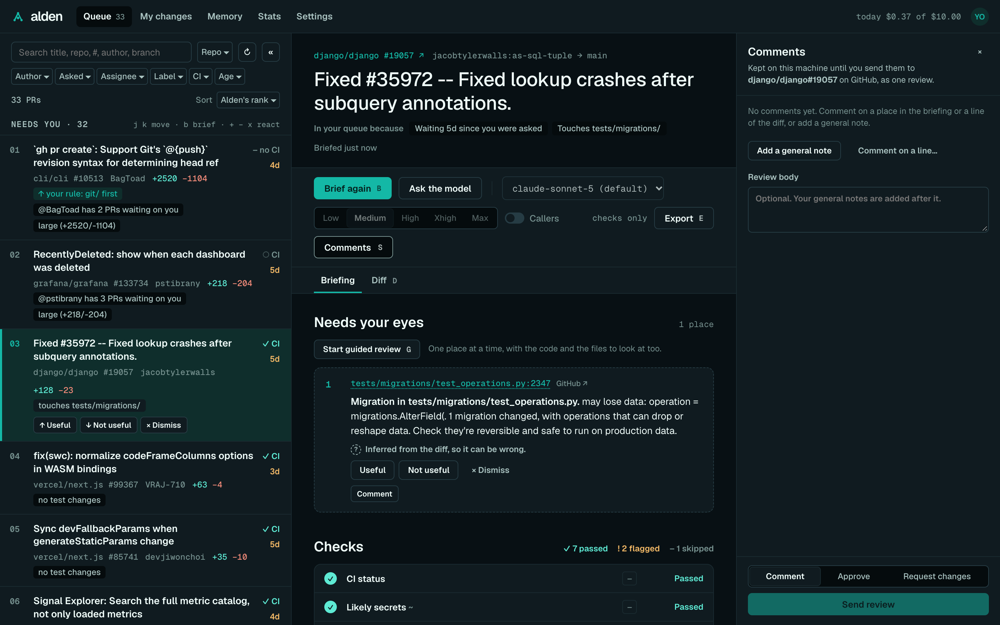
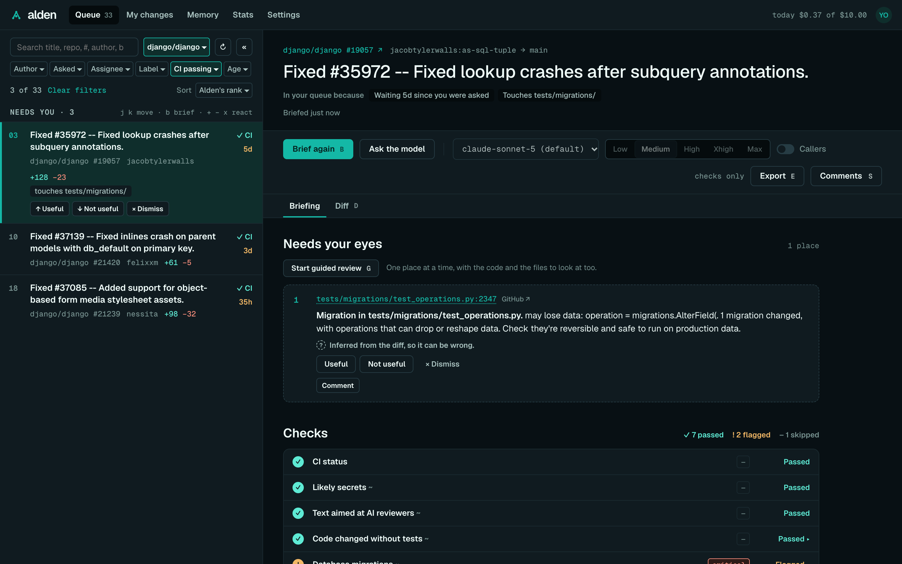
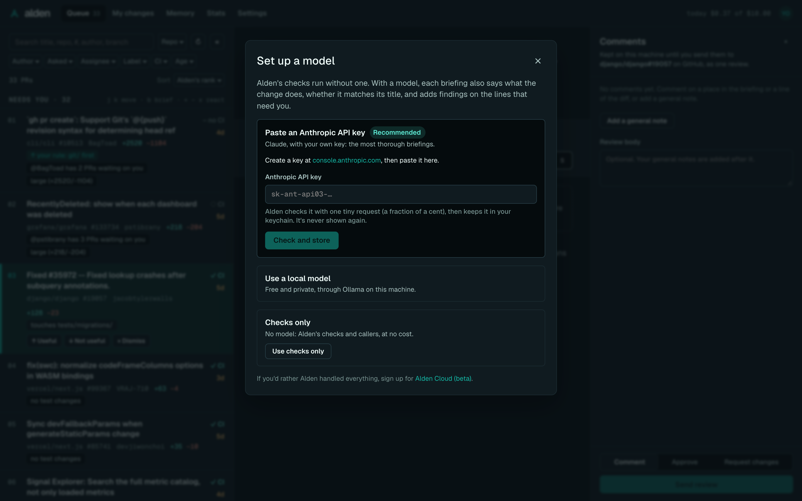
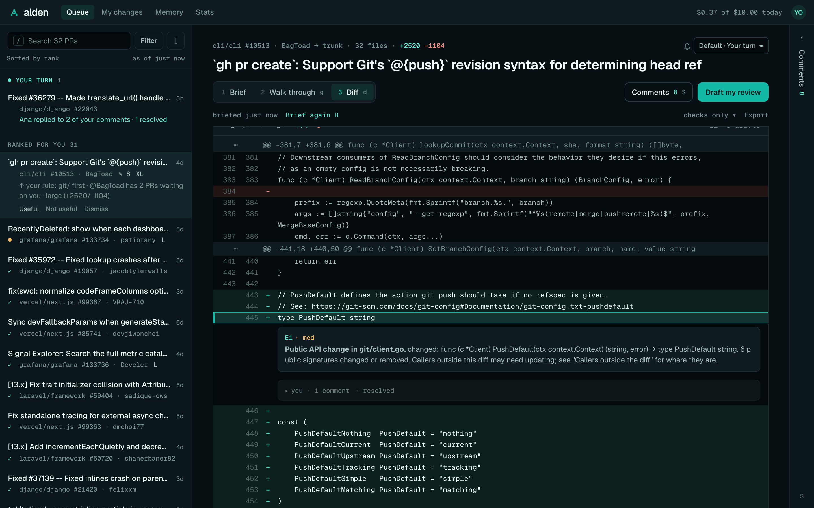
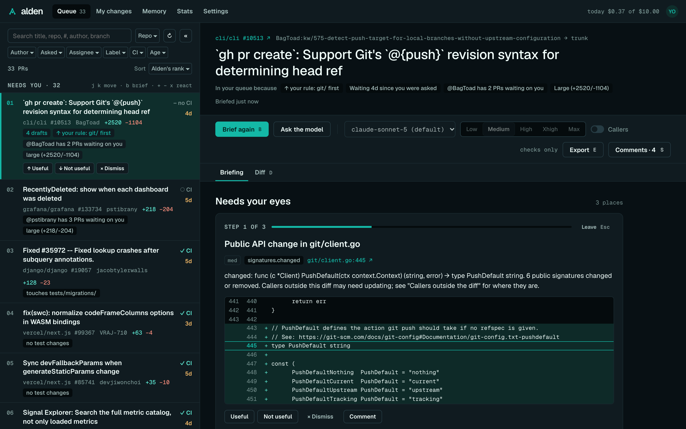
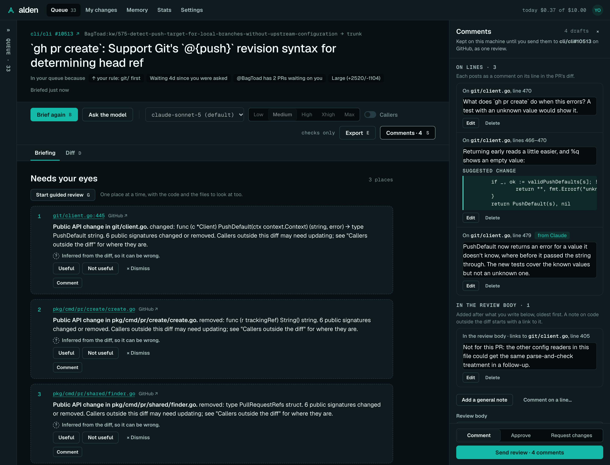
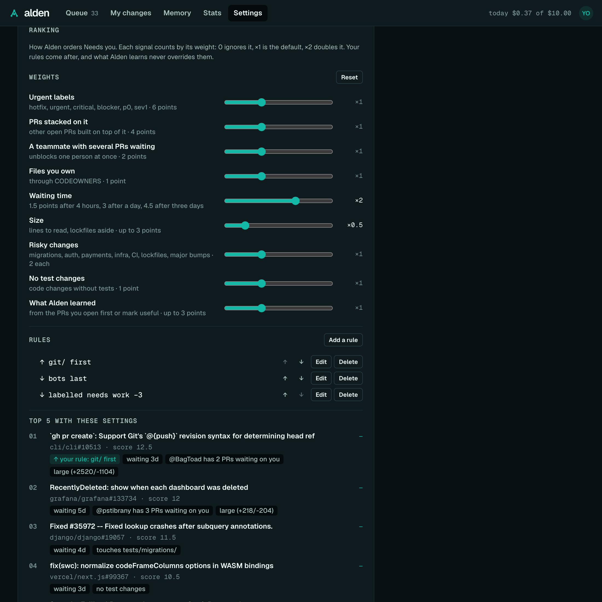

# Alden in your browser

`alden ui` opens your review queue in the browser: the PRs waiting on you, a briefing on each, the PR's diff, and the
comments you're writing, which you send to GitHub as one review. It shows the same briefings as the CLI, from the
same engine, and runs on your machine like the rest of Alden. The [desktop app](desktop.md) shows this same UI in a
window.



## Start it

```sh
cd ~/code/shop        # a clone of a repo you review
alden ui
```

Alden opens the page in your browser. Run it from a clone of a repo you review, as with `alden review`: Alden finds
callers there, and **My changes** reviews that clone's uncommitted changes. PR briefings also find callers in other
clones Alden knows (see [Configuration](configuration.md#clones)).

| Flag | What it does |
| --- | --- |
| `--port <n>` | Serve on this port instead of a free one. |
| `--no-open` | Print the link instead of opening a browser. |
| `--json` | Print one JSON line with the link and port, and don't open a browser. The desktop app uses it, and it turns on background briefings. |

Stop it with Ctrl+C. The link holds a session key, so open Alden from the link it prints; a new run makes a new one.

## The layout

- **The top bar** has the views: **Queue**, **My changes**, **Memory**, **Stats** and **Settings**, and on the right
  today's model spend against your daily cap.
- **The queue** is on the left: the PRs waiting on you, ranked.
- **The PR pane** is in the middle. Pick a PR and its briefing shows here, with **Briefing** and **Diff** tabs once
  it's briefed.
- **The Comments drawer** is on the right. It collects the comments you write on this PR, and sends them.

Below 960px wide, the queue and the PR take turns: pick a PR to open it, and **← Queue** or `Esc` goes back. At 700px
and narrower, the Comments drawer is a full-width sheet over the briefing.

The UI follows your system's light or dark appearance unless Settings picks one. Its fonts (Geist and Geist Mono)
are served by Alden itself, under the SIL Open Font License.

## Signing in

If Alden isn't signed in to GitHub, or GitHub no longer accepts its sign-in, the queue says so and offers:

- **Sign in with GitHub**: a one-time code, with GitHub's page opened for you. Alden picks up your approval by itself.
- **Use my GitHub CLI sign-in**, when the GitHub CLI (`gh`) is signed in.

If you signed in in a terminal instead (`alden auth login`), **I've signed in** looks again. If Alden still can't see
a sign-in, it says why: the keychain refused to answer (as it does for an unsigned development build of the desktop
app), GitHub rejected the token, or there's no sign-in anywhere.

## The queue

The queue has two lanes: **Needs you**, ranked, and **Fast-track**, small low-risk PRs you can clear quickly. Each row
shows the PR's title, repo and author, how long it has waited on you, its size and CI, and the reasons it ranks where
it does. A reason marked ↑ or ↓ comes from your own feedback, and "↑ your rule: payments/ first" from a rule you set
(see [Ranking](#ranking)). See [The review queue](queue.md) for how ranking works.

A PR you reviewed before says so under its title: **Re-review** when you've been asked again since, then when you last
reviewed ("Re-review · reviewed 2 days ago"). Once something has happened to your comments the line counts it too
("3 of your 5 comments resolved"). See [Re-reviews](queue.md#re-reviews).

When you open the page, the last queue shows at once (up to a day old), marked "As of 3 min ago, refreshing…" until
the current one arrives. `r`, or the refresh button, fetches it again. A PR you've opened shows "2 drafts" while it has
comments waiting to be sent.

The first time, a card at the top asks whether to send [anonymous usage stats](telemetry.md). Your answer is kept, and
Settings changes it.

### Search, filters and sort



Alden fetches your whole queue (up to the 1,000 PRs a GitHub search returns), so search and filters cover all of it.

- **Search** (`/`) matches the title, repo, `#number`, author and branch names. Every word has to match, and `@sam`
  means the author sam. `Enter` opens the first match; `Esc` clears the search and goes back to the list.
- **Filters** are the row of menus under the search: repo, author (you, people, bots or AI agents, as
  [Bots and AI agents](queue.md#bots-and-ai-agents) tells them apart), how you were asked (you directly, your
  teams, or one team), assignee (you, unassigned, or someone), label, drafts (hide them, or only drafts; shown when the queue has any), CI
  (passing, failing, running, none) and age (opened today, this week, or before). They combine. A filter that's on is
  highlighted with its value, and the count says "3 of 33" with **Clear filters**.
- **Sort**: Alden's rank (the default), open longest, waiting longest on you, recently updated, or smallest first for
  quick wins. It sorts inside each lane, and dismissed PRs stay at the bottom. Each row keeps its number from Alden's
  rank.

`j` and `k` (or `↓` and `↑`) move through the queue as it's shown, opening each PR. Filters and sort are remembered in
this browser until you reset them; the search isn't.

### Collapse the queue

`[`, or **«** beside the search, folds the queue into a thin rail, so the PR takes the full width. `[` again, or a
click on the rail, brings it back. `/` and `j`/`k` still work while it's folded, and the fold is remembered like the
filters. Below 960px wide there's nothing to fold.

### React to a PR

The selected row has **Useful**, **Not useful** and **Dismiss** (or `+`, `−` and `x`). Useful and not useful teach
Alden which PRs like it to rank higher or lower ("ranked lower: you usually skip Dependabot PRs"). **Dismiss** moves
a PR to the bottom until it changes; dismiss it again to undo. Briefing a PR from the queue counts as opening it,
which teaches Alden too. See [The review queue](queue.md) and [Learning and memory](memory.md).

## A briefing

Pick a PR, then **Brief me** (or `b`). Alden fetches the PR, finds the callers of the code it changes, runs its checks
and asks the model, showing each stage as it goes. `Esc` stops it. A briefing keeps running if you look at another PR,
and it's there when you come back.

The briefing follows the CLI's order. See [Briefings and checks](checks.md) for what's in it.

- **Needs your eyes**: the few places to look first (3 unless you change it in Settings), each with its file and line,
  the reason, and the check that raised it. A place's `file:line` opens the [Diff tab](#the-diff-tab) at that line;
  **GitHub ↗** beside it opens the PR's "Files changed" on GitHub.
- **Checks**: every check Alden ran, with its evidence, and what it couldn't check.
- **Callers outside the diff**, from the [code graph](code-graph.md).
- **What the model says**, when it was asked: what the change does, whether it matches its title, and its findings.

Each place, finding and flagged check has **Useful** and **Not useful**, which teach Alden what you look for, and
**Dismiss**, which hides one place on this PR. A model finding raised because of one of your notes says "Because of
your note: …". Useful on it confirms the note; after Not useful, it offers **Stop applying this note to app/api?**
(**Stop applying**, then **Undo**) and **Edit the note**, and without either nothing changes. See
[Findings from your notes](memory.md#findings-from-your-notes). **You missed something** tells Alden what it should have flagged.
"Shaped by your feedback" says what your feedback changed in this briefing.

### Model, effort and callers

The toolbar above the briefing sets the next review: **Ask the model** or not, which model, which effort, and
**Callers** (whether to find callers). The line beside them shows the per-briefing cap, or "checks only". These
choices last until you close the tab; Settings changes the defaults.

Above the briefing, Alden says which clone the callers come from, when it isn't the folder `alden ui` runs in. With no
clone of the PR's repo, it says so, and how to point Alden at your clones (`alden config set clones.folders ~/src`).

### Set up a model



With no model set up, the toolbar offers **Set up a model** instead of Ask the model. It has the same three choices as
`alden setup`, in the same order:

1. **Paste an Anthropic API key.** Alden checks it with one tiny request, which costs a fraction of a cent, then keeps
   it in your keychain. The page never gets it back.
2. **Use a local model** through Ollama. Alden recommends one for your machine's memory and downloads it, with
   progress, if Ollama doesn't have it. Local models flag less than Claude.
3. **Checks only.**

Below them is a link to [Alden Cloud (beta)](https://getalden.dev/cloud). The next briefing uses the new model, with no
restart. See [Models, providers and budgets](models.md).

### When it was briefed, and Re-brief

Under the title, the briefing says when it was made ("Briefed 30 min ago"). Once the PR or its base has moved on, it
says what changed, with **Re-brief**: "main has 4 new commits since" (callers merged there since aren't in it) or
"the PR has 2 new commits". Alden asks GitHub, one request, when the briefing is shown and when the window comes back to
the front, at most once a minute. It doesn't poll. See
[Keeping up with the base](code-graph.md#keeping-up-with-the-base).

### Export

**Export** (or `e`) in the toolbar copies, saves or prints the briefing:

- **Copy as Markdown** puts the same document as [`alden review --markdown`](commands.md#alden-review) on the
  clipboard.
- **Save as Markdown** downloads it as `owner-repo-123-briefing.md`.
- **Print / Save as PDF** opens the print dialog, where your system offers PDF. The printout is the briefing alone, in
  light colours, with places and checks kept whole across pages.

The Markdown leaves out your memory notes and what your feedback changed, keeps secrets masked as the briefing shows
them, and ends with the model, its cost and when it was briefed. A line beside the button says what happened
("Copied as Markdown.").

## The Diff tab



Once a PR is briefed, **Diff** (or `d`) shows the code itself, so you don't have to go to GitHub to read it.

- Every changed file, with its `+` and `−` counts, "old → new" for a rename, and a note for a binary file or one too
  large for GitHub to send (with a link to it on GitHub).
- Lines are unified, with the old and new line numbers. Each file opens and closes from its header, or `f`;
  **Collapse all** folds them all.
- Alden's places to look are marked **E1**, **E2**… at their lines (a place on a whole file sits in its header). `]`
  and `[` go to the next and previous place.
- Your comments show as a ✎ badge at their lines. Hover one for its text, or click it to open the text under the line.
- On a PR, **+** beside a line starts a comment on it in the Comments drawer. Shift-click a second line, or drag, for
  a range on the same side of one hunk.
- On a PR, the review threads already on it show under their lines: who's in each and how many comments, open
  unless resolved. **Reply** opens that thread's Reply box in the Comments drawer. See
  [Replying in a thread](comments.md#replying-in-a-thread).

A marker that's been on screen for 1.5 seconds counts as a place you saw, which Alden learns from when you send your
review: see [Places you saw](memory.md#places-you-saw).

For a PR, the diff is the PR's latest push. If that's newer than the briefing, a line above the diff says so, since
places may have moved. For **My changes**, it's your uncommitted changes, as the briefing read them.

### Since your review

On a PR you reviewed before, the Diff tab opens on **Since your review**: only what changed from the commit you last
reviewed to the PR's head, so a second look starts where your first one stopped. **Whole PR** shows everything.

- Places to look and your comments still show at their lines when the narrower diff has them. The old side is the
  commit you reviewed rather than the PR's base, so comments on removed lines show, and are written, in **Whole PR**.
- If the commit you reviewed isn't in the PR's history any more (a force-push or rebase), the tab shows the whole PR
  and says so. If nothing has been pushed since, it says that instead.
- If the author merged the base branch in since your review, its changes are part of "since" too.
- It's one GitHub request (the compare API, which lists up to 300 files), kept like the whole diff while `alden ui`
  runs.

Large diffs stay quick: rows render as you scroll to them, and files over 400 lines of diff start collapsed, with
**Show**. Alden keeps a PR's diff per push while `alden ui` runs, so opening it again is instant. The tab you were on
is remembered until you close the window.

## Guided review



When a briefing has places that need your eyes, **Start guided review** (or `g`) takes them one at a time, in
Alden's order. Each step shows:

- "Step 2 of 4", the place's title, and why it's there: its reason, the check, and how severe.
- The code at that place, a few lines either side, from the PR's diff.
- **Look at these too**: the files worth opening beside it, from the [code graph](code-graph.md#related-files). Other
  callers of the changed code, tests that use it or import its file, and files that import it, each with its line. A
  file in the diff opens its lines in place; the rest link to the file on GitHub at the PR's head.
- **Useful**, **Not useful** and **Dismiss**, as in the briefing, and **Comment**, which opens the Comments drawer's
  editor at that place.

After Alden's places, the model's other findings that point at code follow as extra steps, with **Comment** too. A
step from one of your notes says "Because of your note: …" and has the same offer after Not useful.

`n` and `p` move between steps. `Esc` leaves, and **Resume guided review at step 3** takes you back there while the
window is open. The last step offers **Finish: review your comments**, which opens the drawer at the review body.
For **My changes**, guided review shows the places and their files to look at, without the code.

On a PR, a step that's been in front of you for 1.5 seconds counts as a place you saw, which Alden learns from when you
send your review: see [Places you saw](memory.md#places-you-saw). Nothing about it leaves your machine.

## Comments and sending a review

You write your review in Alden, beside the briefing, and send it to GitHub as one review. Nothing posts until you send
it. See [Comments and sending a review](comments.md) for the same from the terminal.



### The Comments drawer

**Comments · 3** (or `s`) in the PR's toolbar opens and closes the drawer. It says where your comments go: "Kept on
this machine until you send them to acme/shop#412 on GitHub, as one review." It lists them by where they'll post:

- **On lines**: each with its file and line or range, its text and any suggested change, with **Edit** and
  **Delete**.
- **In the review body**: your general notes, which follow what you write in the body. A linked note says "links to
  py/orders/tasks.py, line 5"; hovering it names the commit its link shows, the PR's head when you wrote it.

- **Replies in threads**: where each reply goes, "Reply in thread on src/pay.ts:40, and resolve it".

Below them are **Add a general note**, **Comment on a line…**, the review body, and the PR's **Conversation**: its
review threads, yours first and open ones first, each with **Reply** and **Resolve when sent**. A reply or a resolve
is a draft like any other, sent with your review (see [Replying in a thread](comments.md#replying-in-a-thread)). At the bottom, always in view, are
the verdict (**Comment**, **Approve** or **Request changes**) and **Send review · 3 comments**.

The drawer stays open or closed as you left it in this window, and starts open when the window is wide enough for it
beside the queue. ×, `s` or `Esc` puts it away.

### Write a comment

There's one editor, always in the drawer. It opens from:

- **Comment** on a place in "Needs your eyes", on a flagged check's evidence line, on something the model also
  noticed, or on a step of guided review. `c` does the same for the place you're on.
- **+** beside a line in the Diff tab, or a range picked there.
- **Comment on a line…** in the drawer: pick a changed file and give a line (`12`) or a range (`4–9`). A removed
  file's line is on the old side.
- **Add a general note**, for the review body.

The editor names exactly where the comment goes: "Comment on py/orders/pricing.py, line 4", or "lines 4–9" for a
range. `⌘↵` (`Ctrl+↵`) saves; `Esc` cancels and puts focus back where you were. The place keeps a short list of your
drafts on it.

- **Suggest a change** (lines on the new side only) adds a code box, started from the line's text when Alden has it.
  It posts as a suggested change the author can accept on GitHub. Left empty, it suggests deleting the lines. A
  suggestion needs no words of its own.
- **On code outside the diff.** GitHub only takes inline comments on lines in the PR's diff. On any other line (a
  caller in an unchanged file, say), the editor says so before you save: "This line isn't in the PR's diff, so it goes
  in the review body with a link to it." It's saved as a
  [linked note](comments.md#comments-on-code-outside-the-diff), which starts with a link to that line at the PR's
  head. A place or finding about a whole file gets one too, linking to the file. A suggestion in a linked note posts as
  code headed "Suggested change", for the author to copy.

In the Diff tab, a linked note shows at its line, or on its file, when the diff has it.

### Claude's drafts, and outdated drafts

Drafts that Claude Code added (through [the plugin or `alden mcp`](claude-code.md)) are marked **from Claude**, so you
read them before they go out under your name. Claude can draft comments, but never send them.

Drafts Alden made from its model's findings are marked **Drafted by Alden**, with **Keep**, **Edit** and **Drop**, and
**Keep all** / **Drop all** at the top of the drawer. Until you keep or edit one, it isn't sent: the drawer says how
many won't be, and **Send review** counts only what will post. The briefing marks a finding with one **Draft ready**.
See [Alden's drafts](comments.md#aldens-drafts).

### Drafting with Alden

With a model set up, **Draft my review** (beside **Comments**, and in the drawer once the PR is briefed) asks the
model, in one call within your caps, to draft comments for the places to look and the model's findings that have no
comment near them yet. While it runs it says "Drafting…"; then it opens the drawer on the new drafts and says how many
it made, what the call cost and how many places it skipped, or why it couldn't. Without a model, the drawer offers
**Set up a model** instead.

Each comment and reply box has **Draft with Alden**: it fills an empty box with the model's text for you to edit
(**Undo** empties it), or, when you've written something, shows Alden's version of it with **Use it** and **Keep
mine**. **Cancel** stops it while it's drafting. It saves nothing: you save, and the comment is yours.

On a PR with text aimed at AI reviewers, neither drafts: **Draft my review** says why, and the boxes say "Alden won't
draft here". See [Drafting with Alden on demand](comments.md#drafting-with-alden-on-demand).

A draft written before the PR's latest commits is marked **Outdated** when its lines changed. **Rewrite** puts it in a
new comment on the current code (check the line), or delete it. The review won't send until you've done one or the
other.

### Send the review

Pick the verdict: **Comment**, **Approve**, or **Request changes** (which needs a body). Then **Send review**. Nothing
posts yet: a summary shows exactly what will, the PR, the verdict, the body (yours, then your general notes) and each
comment with its file, line and suggestion. Before **Approve**, it also lists the places Alden flagged that you didn't
comment on.

Only the button in the summary sends it; **Back** returns to your drafts. Afterwards the drawer says "Sent to GitHub",
with a link to the review, and, when Alden learned something from it, one line under that: "Alden learned: you care
about callers flags (2 of 3)". If GitHub refuses, it shows why and keeps your drafts.

## My changes

**My changes** briefs your uncommitted changes (staged, unstaged and untracked) in the clone `alden ui` started in,
before you open a PR. It has the same toolbar, Diff tab and guided review as a PR, without comments.

## Memory

**Memory** lists each repo Alden knows about, then what you look for and what you skip there. Each item says where it
came from and what it changes, with **Edit** (for notes), **Forget** and **Undo**. A note says how many reviews
confirmed it ("confirmed 3×") and has **Apply under app/api again** for each place you stopped it. A learned item lists what it was
learned from, newest first: "from your review of acme/shop#412, Oct 8", then "and 3 more". A switch pauses learning, and
**Tell Alden something** adds a note ("Money is in cents, never floats"). See [Learning and memory](memory.md).

## Stats

**Stats** shows a repo's time to first review and review cycle time, week by week, before and after you started using
Alden there (or a date you pick), over the last 90 days or another window. See
[`alden stats`](commands.md#alden-stats).

## Settings

Settings change your user config, like `alden config set`; a repo's `.alden.toml` still overrides them there.

- **Model**: the default model and effort.
- **Spend caps**: per briefing and per day. When a briefing would pass its cap, Alden doesn't ask the model and shows
  the checks.
- **Briefings**: how many places "Needs your eyes" shows, 1 to 10 (3 by default).
- **Anthropic API key**: stored in the keychain, like `alden auth model`. The field is write-only: the page only learns
  where the key comes from.
- **Your feedback**: how often you found Alden's places useful, and **Export redacted feedback**.
- **Learning**: **Learn from my reviews** (on by default). Off, Alden stops noting which places you saw and learns only
  from Useful and Not useful. See [Places you saw](memory.md#places-you-saw).
- **Drafts**: **Draft comments for me** (on by default, `drafts.auto`). Off, a model briefing drafts no comments.
- **Your queue on this machine**: which organisations and repos the queue covers, and what to leave out. The queue
  says when it's narrowed.
- **Ranking**: see below.
- **Usage stats**: on or off. See [Usage stats](telemetry.md).
- **Appearance**: match the system, light or dark.
- **Today**, beside them: today's spend against your daily cap, by PR.

The desktop app adds **Command line tool**, **While you're away** and **Notifications**: see
[The desktop app](desktop.md#settings-only-in-the-app).

### Ranking



**Ranking** sets [how the queue ranks](queue.md#your-ranking):

- **Weights**: a slider per signal, from off (0) to ×3 here, ×1 by default, **Re-reviews** included. **Reset** puts
  them all back.
- **Rules**: add, edit, delete and reorder them. Each takes any of a path, label, author, repo, base branch and title,
  and puts PRs first or last, or boosts or lowers them. A rule's reason shows on the queue's rows, marked as yours
  ("↑ your rule: payments/ first").
- **Top 5 with these settings**: your current queue, re-ranked as you change things, with each PR's move against your
  saved settings. Without a queue to rank (signed out, offline), it says why.

Nothing applies until **Save ranking**; **Discard changes** goes back. In the desktop app, Ranking also sets how many
top PRs to keep briefed in the background.

## Keyboard

Keys never fire while you're typing in a text box.

| Key | Does |
| --- | --- |
| `j` or `↓` | Next PR, with its briefing |
| `k` or `↑` | Previous PR |
| `/` | Search the queue (opens it first if it's folded). In the search, `Enter` opens the first match and `Esc` clears it |
| `[` | Fold the queue to a rail, or bring it back (windows 960px and wider; in the Diff tab, `[` is the previous place) |
| `r` | Refresh the queue |
| `o` | Open this PR on GitHub |
| `+` `−` `x` | Useful, Not useful, Dismiss on this PR |
| `b` | Brief me on this PR |
| `e` | Open the Export menu (`↑` `↓` move, `↵` picks, `Esc` closes) |
| `d` | Switch between the briefing and its Diff tab |
| `]` `[` | In the Diff tab: next and previous place to look (E1, E2…) |
| `f` | In the Diff tab: open or close the file you're in |
| `g` | Start guided review, or resume it at the step you left |
| `n` `p` | Next and previous step in guided review |
| `s` | Open or close the Comments drawer |
| `c` | Comment on the place you're on (a place in "Needs your eyes", an evidence line); elsewhere, open "Comment on a line…" |
| `⌘↵` / `Ctrl+↵` | Save the comment you're writing |
| `Esc` | Cancel the comment you're writing, or leave the send summary; leave guided review; close the Comments drawer; stop a running briefing; in a narrow window, back to the queue |

## Security

The UI's server can use your GitHub sign-in and spend your model budget, so it's locked down:

- It listens on 127.0.0.1 only, so other machines can't reach it.
- Every API call needs the session key in the link `alden ui` prints. The key travels in the link's `#fragment`,
  which browsers never send to servers. The UI keeps it for that tab only and takes it out of the address bar.
- Calls must come from the server's own address, which stops other websites, including through DNS rebinding.
- Pages get a strict Content Security Policy and don't send referrers.

Don't share the link while `alden ui` is running. A new run makes a new key. See [Security model](security.md).

## Working on the UI

See [`packages/ui/README.md`](../packages/ui/README.md). `pnpm ui:demo` serves the UI over the recorded public PRs,
with no GitHub or model calls, for UI work; `pnpm screenshots` takes the pictures on this page from it. Every route
of the local API is listed in [Architecture](architecture.md#the-web-uis-server).
